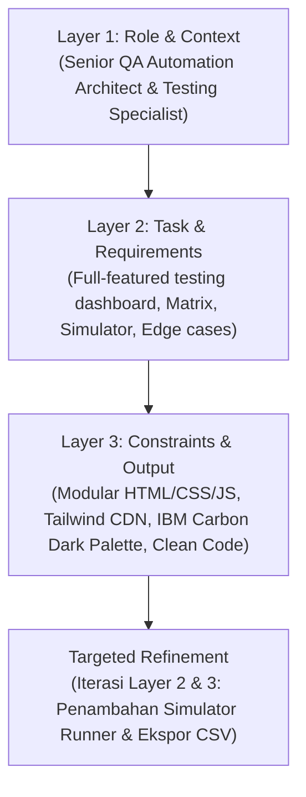

# TestCraft AI - Intelligent Test Suite & Edge-Case Generator Agent

> **Proyek Capstone - IBM SkillsBuild x Hacktiv8 AI Builders Challenge (IT Track)**  
> **Mata Kuliah:** Kapita Selekta (IF-A) - Program Studi Informatika  
> **Institusi:** Universitas Pembangunan Nasional "Veteran" Yogyakarta  
> **Pengembang:** Rafi Dzaka Pratama Putra (NIM: 123240104)  
> **AI Coding Assistant Tools:** IBM Bob (Agent Mode)

---

## 📌 1. Deskripsi Proyek
**TestCraft AI** adalah sebuah platform AI Agent terintegrasi yang dirancang untuk mengotomatisasi pembuatan test suite perangkat lunak, analisis nilai batas (*Boundary Value Analysis*), partisi ekivalensi, serta skenario pengujian celah keamanan (*Security & Edge Cases*). 

Dibangun dengan pendekatan **Vibe Coding** dan **Context Engineering** menggunakan **IBM Bob**, aplikasi ini membantu tim pengembang dan QA Engineer mentransformasikan logika kode sumber (Python, JavaScript, Java, Go) maupun kebutuhan bisnis (Agile User Stories) menjadi rangkaian pengujian otomatis siap pakai secara instan.

---

## ✨ 2. Fitur Utama
1. **Multi-Modal Input Specification:**
   - Mendukung input berupa potongan kode sumber (*Source Code*), dokumen kebutuhan Agile (*User Story / Acceptance Criteria*), hingga skema API RESTful.
   - Dilengkapi *Preset Templates* bawaan (E-Commerce Checkout, User Auth & Password Policy, Bank Account Transfer, dan Registration Story).
2. **Autonomous Test Suite Synthesis:**
   - Menghasilkan kode pengujian berstandar industri untuk berbagai framework pengujian populer:
     - **Python:** `pytest` + `unittest.mock` (parameterized test cases, exception assertions).
     - **JavaScript:** `Jest` / `Vitest` (describe/test blocks, expect matchers).
     - **Java:** `JUnit 5` + `Mockito`.
     - **Go:** `testing` + `testify`.
     - **BDD:** Gherkin Feature syntax (`Given-When-Then`).
3. **Equivalence Partitioning & Boundary Matrix:**
   - Tabel visual interaktif yang memetakan setiap skenario pengujian berdasarkan ID, Kategori (*Happy Path, Boundary, Negative, Security*), Input Data, *Expected Output*, dan Level Prioritas (*Critical, High, Medium*).
   - Fitur ekspor matriks ke format **CSV**.
4. **Edge Cases & Security Vulnerability Analyzer:**
   - Mendeteksi titik rentan logika: pembagian dengan nol, floating-point rounding error, eksploitasi parameter negatif, bypass role otorisasi, dan batas limit transaksi perbankan.
5. **Interactive Live Test Runner Simulator:**
   - Simulator terminal interaktif di browser yang memvisualisasikan eksekusi test runner baris demi baris, progress bar real-time, latensi eksekusi, serta kalkulasi persentase *Branch Coverage*.
6. **Prompt Architecture Inspector:**
   - Modal interaktif yang menampilkan transparansi arsitektur prompt 3-layer (Role, Task, Constraints) dan alur *Targeted Refinement*.

---

## 🏗️ 3. Arsitektur Prompt 3-Layer (IBM Bob)
Proyek ini dibangun secara iteratif menggunakan framework prompt 3-layer sesuai silabus IBM:



1. **Layer 1 (Role & Context):**
   > *"Bertindak sebagai Senior QA Automation Architect dan Frontend Specialist di IBM AI Builders Challenge. Batasan: Arsitektur 3 file terpisah (index.html, style.css, app.js), tanpa bundler eksternal, siap dijalankan dengan web browser/Live Server."*
2. **Layer 2 (Task & Requirements):**
   > *"Bangun web app 'TestCraft AI' dengan fitur: multi-format input, generator test suite (PyTest/Jest), tabel matriks partisi batas, deteksi celah keamanan, dan simulator eksekusi pengujian."*
3. **Layer 3 (Constraints & Output):**
   > *"Desain dark-mode modern terinspirasi IBM Carbon Design System, responsif, zero console errors, modular, berikan komentar kode terstruktur."*

---

## 📂 4. Struktur Direktori Proyek
```text
capstone-project/
├── index.html           # Struktur antarmuka semantik & layout dashboard
├── style.css            # Styling custom, scrollbar, animasi pulse & glassmorphism
├── app.js               # Logika aplikasi, generator test suite, state management, simulator
├── README.md            # Dokumentasi teknis proyek
└── samples/             # File kode sumber sampel untuk pengujian
    ├── ecommerce_checkout.py  # Logika kalkulasi diskon & checkout e-commerce
    ├── auth_service.js        # Logika validasi password & RBAC pengguna
    ├── bank_transfer.py       # Logika transaksi rekening & batasan limit transfer
    └── user_story_auth.md     # Spesifikasi kebutuhan registrasi & autentikasi
```

---

## 🚀 5. Cara Menjalankan Proyek

### Opsi A: Menggunakan IBM Bob (Sesuai Silabus Pelatihan)
1. Buka aplikasi **IBM Bob** di komputer Anda (`C:\Users\Pongo\AppData\Local\Programs\IBM Bob\IBM Bob.exe`).
2. Pilih menu **File** -> **Open Folder...** -> Pilih folder `capstone-project`.
3. Pasang ekstensi **Live Server** di IBM Bob (jika belum terpasang).
4. Klik kanan pada file `index.html` -> Pilih **Open with Live Server**.
5. Aplikasi akan terbuka secara otomatis di browser pada alamat `http://127.0.0.1:5500`.

### Opsi B: Menggunakan Python HTTP Server
Jalankan perintah berikut di PowerShell / Terminal:
```bash
cd "D:\.KULIAH\Semester 5\Kapita Selekta\IBM\capstone-project"
python -m http.server 8000
```
Buka browser dan akses: `http://localhost:8000`

### Opsi C: Buka Langsung di Web Browser
Cukup klik ganda (*double-click*) file `index.html` untuk membukanya langsung di Google Chrome, Microsoft Edge, atau browser modern lainnya.

---

## 🧪 6. Cara Menguji Aplikasi
1. **Menggunakan Preset Sample:**
   - Pada bilah navigasi atas, pilih salah satu sampel pada dropdown (misal: `🛒 E-Commerce Checkout (Python)`).
   - Klik tombol **Load**.
   - Klik tombol **Sintesis Test Suite dengan IBM Bob Agent** (atau tekan `Ctrl+Enter`).
2. **Melihat Hasil Sintesis:**
   - Tab **Generated Test Suite:** Melihat kode pengujian `pytest` lengkap. Klik **Salin** atau **Simpan** untuk mengunduh file `.py`.
   - Tab **Test Matrix:** Menampilkan 14 kasus uji terstruktur. Klik **Export CSV** untuk mengunduh data matriks.
   - Tab **Edge & Boundary:** Memeriksa analisis nilai batas dan mitigasi keamanan.
   - Tab **BDD Gherkin:** Memeriksa skenario format Cucumber.
3. **Menjalankan Simulator Pengujian:**
   - Buka tab **Live Test Runner**.
   - Klik tombol **Jalankan Pengujian (Execute All)**.
   - Perhatikan animasi progress bar dan log eksekusi terminal yang memverifikasi setiap assertion secara real-time hingga tercapai status `14 passed`.

---

## 📝 7. Lisensi & Hak Cipta
Dikembangkan untuk keperluan akademik tugas mata kuliah **Kapita Selekta**, Jurusan Informatika, Fakultas Teknik Industri, UPN "Veteran" Yogyakarta dan submission Capstone Project **IBM SkillsBuild x Hacktiv8**.
